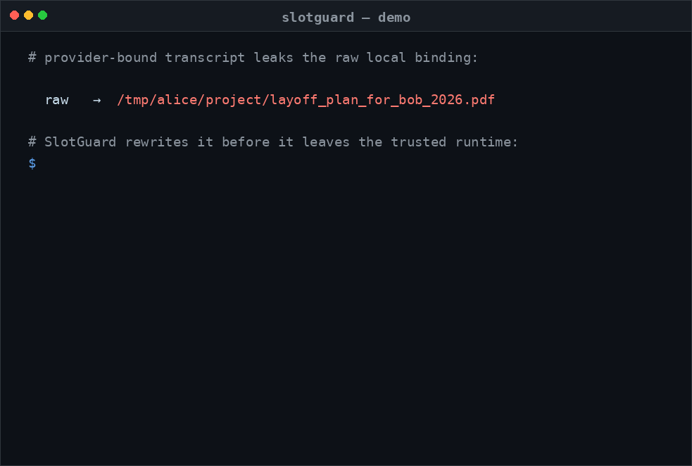

# SlotGuard

SlotGuard is a local transcript boundary for coding agents. It rewrites
provider-bound transcript state before it leaves the trusted runtime,
stripping raw structural bindings and credentials while preserving the
path-shaped and credential-shaped cues that upstream models still need for
workflow reasoning.



## Workspace Layout

- `crates/slotguard-core` — core abstraction, rebinding, credential
  sanitization, format-preserving synthetic substitution (FPS), and the
  session-scoped semantic entity graph (SEG)
- `crates/slotguard-cli` — local inspection and demo commands
- `crates/slotguard-experiments` — the paper benchmark harness
- `scripts` — reproducibility and verification helpers

## Quick Start

```bash
cargo run -p slotguard-cli -- demo-path /workspace/proj_guard/VibeGuard/README.md \
  --workspace-root /workspace/proj_guard

cargo run -p slotguard-cli -- semantic-detect layoff_plan_for_bob_2026.pdf \
  --kind filename --config ./config.example.toml
```

## Reproducibility

One command mirrors the paper flow:

```bash
cp .env.example .env && set -a && source .env && set +a
./scripts/repro_paper.sh
```

This runs only the deterministic experiments by default. Opt in to the
local-model, model-generalization, and TAC-derived replay probes with
`SLOTGUARD_RUN_LOCAL=1`, `SLOTGUARD_RUN_MODEL_GEN=1`,
`SLOTGUARD_RUN_TAC_LITE=1`, and `SLOTGUARD_RUN_TAC_LITE_MODEL_GEN=1` when
the corresponding endpoints are available.

See [REPRO.md](./REPRO.md) for prerequisites, environment variables,
and the expected output files.

### Local semantic endpoint

SlotGuard can optionally call a local OpenAI- or Anthropic-style HTTP LLM
endpoint for advisory slot proposals. The model only proposes spans and
slot types; the runtime verifies each span appears verbatim in the local
input before it becomes a placeholder.

```bash
ollama pull qwen2.5-coder:1.5b
ollama serve
```

### Session state

Each session pins a per-session HMAC key and an append-only slot ledger
under `~/.slotguard/sessions/<id>/` (`session_key`, `index.json`,
`slots.jsonl`). Override the base dir with `SLOTGUARD_HOME`. Different
sessions yield different handles for the same raw value, so handles are
unlinkable across runs.

## Citation

If this repo is helpful for your research, please cite our paper.

```
@inproceedings{
xia2026slotguard,
title={SlotGuard: Stop Oversharing Private Local Context in {LLM} Agent Transcripts},
author={Haocheng Xia and Yongjoo Park},
booktitle={Second Workshop on Agents in the Wild: Safety, Security, and Beyond},
year={2026},
url={https://openreview.net/forum?id=waW0KyByrv}
}
```
